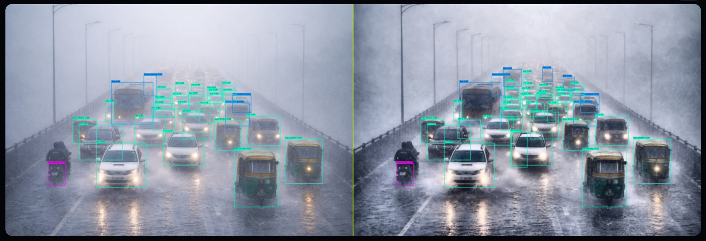
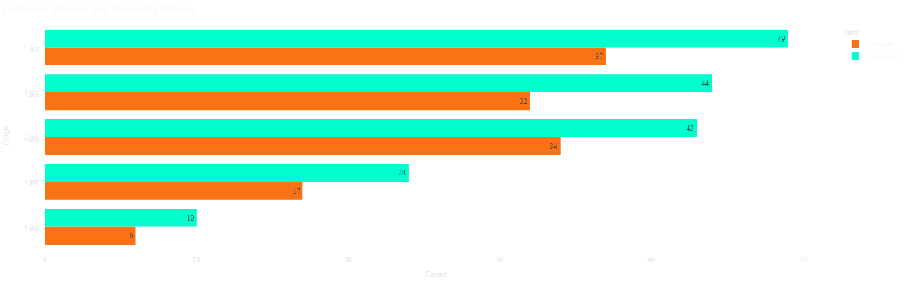
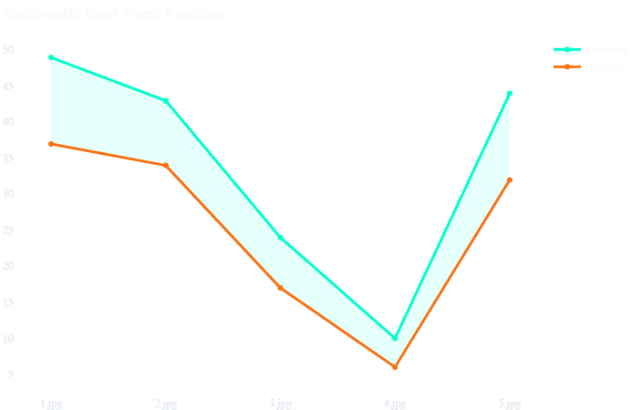
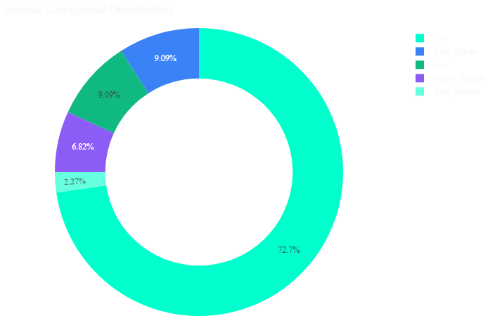
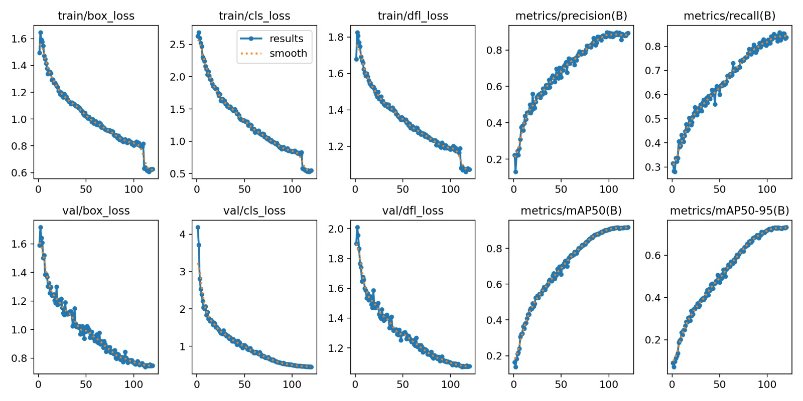
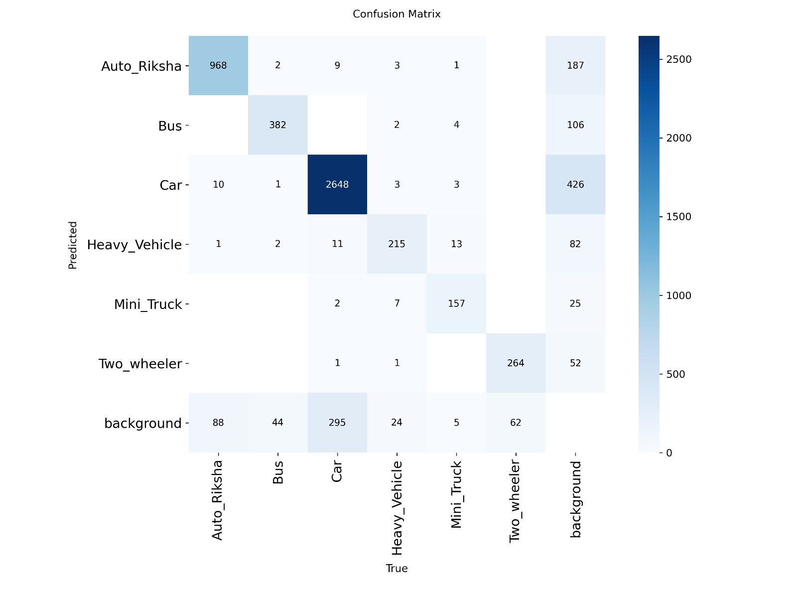
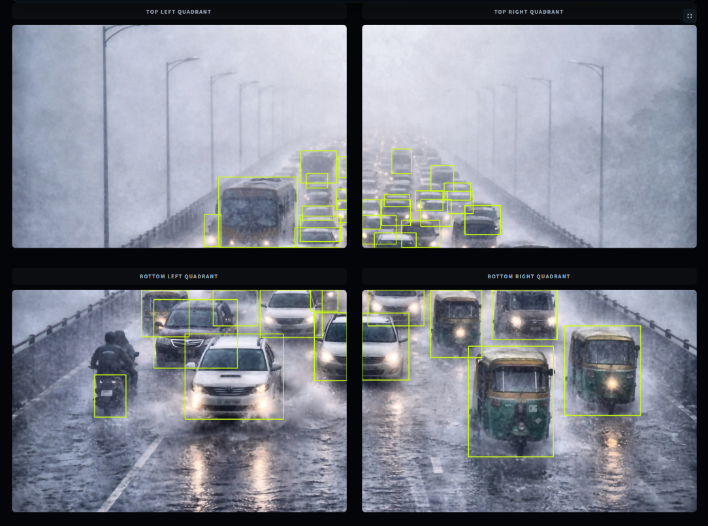

# Vehicle Detection on Indian Roads Under Rainy Weather Using YOLOv8x and Image Enhancement

A weather-aware vehicle detection project built around Indian traffic: heterogeneous vehicle types, unstructured roads, and heavy monsoon rain that most detection models are not trained to handle.

---

## 🚦 Overview

Standard object detection models are usually trained and benchmarked on clean, structured datasets from Europe, the US, or China, with well-marked lanes, predictable traffic, and clear weather. That does not describe an Indian monsoon street: auto-rickshaws weaving between buses, waterlogged roads acting like mirrors, rain streaks blurring object boundaries, and vehicle spray fogging up entire lanes.

This project combines a custom, manually annotated rainy-weather dataset with a **self-built adaptive image enhancement pipeline** and a fine-tuned YOLOv8x model. On the rain-degraded test images evaluated, the enhancement step increased the number of vehicles detected, with no decrease observed in any evaluated scene.

> **A note on scope:** This repository contains the code that was actually implemented: the adaptive enhancement pipeline, the YOLOv8x training script, and a clean-vs-rain-vs-enhanced evaluation dashboard. The dataset and trained weights are **not** included. Some ideas that were explored or proposed (SAHI tiled inference, IoM duplicate suppression, per-class confidence thresholds) are **not implemented here**; see [Not Included](#-not-included-in-this-repository).

---

## 🎯 Problem Statement

Rainy weather degrades vehicle detection accuracy through:
- **Rain streaks and noise:** high-frequency visual interference that obscures object edges
- **Low light / overcast conditions:** reduced contrast and visibility
- **Fog and haze:** washed-out colors and contrast, especially at range
- **Blur:** from rain-soaked lenses or camera shake
- **Highly heterogeneous traffic:** cars, auto-rickshaws, two-wheelers, buses, and trucks sharing the same unstructured lanes with no consistent discipline

Existing global datasets (Cityscapes, BDD100K, DAWN, ACDC) do not capture this combination of adverse weather *and* Indian road conditions, which is the gap this project targets.

---

## 🧩 Key Components

### 1. Custom Rainy-Weather Dataset (not included in this repository)
- About 3,000 images collected from mobile cameras, CCTV, and dashcams across Indian urban roads, highways, and intersections during monsoon conditions
- Filtered down to **1,800 images** after removing blur, occlusion, and redundant samples
- Manually annotated in **Label Studio** (no AI-assisted labeling) across **6 vehicle classes**: Car, Bus, Heavy Vehicle, Auto-Rickshaw, Two-Wheeler, Mini Truck
- Split 70:20:10 (train:val:test)

### 2. Adaptive Image Enhancement Pipeline (`enhanced_pipeline.py`)
Rather than applying a fixed sequence of filters to every image, the pipeline first **diagnoses** what is wrong with a frame, then applies only the fixes needed:

- **Degradation profiling:** measures Laplacian variance (blur), mean brightness (low light), dark-channel mean (fog), and noise level to detect which conditions apply
- **Low-light correction:** gamma lift plus CLAHE (on the LAB L-channel) to recover shadow detail without blowing out highlights
- **Rain/noise removal:** Non-Local Means denoising
- **Fog removal:** Dark Channel Prior dehazing
- **Blur correction:** unsharp masking

A clean image passes through untouched, while a degraded image only receives the corrections it needs.

### 3. YOLOv8x Training (`training.py`)
- Fine-tuned from COCO pre-trained `yolov8x.pt` weights (transfer learning)
- 120 epochs, AdamW, cosine LR decay, batch size 4, input size 640x640
- Originally run in a Kaggle notebook, so the `data` and `project` paths must be changed to run elsewhere

### 4. Clean vs. Rain vs. Enhanced Evaluation (`final_pipeline.py`)
An end-to-end evaluation script that:
- Runs the trained YOLOv8x model on paired **clean**, **rain**, and **enhanced** versions of the same scenes
- Counts detected vehicles per class in each condition
- Builds a comparison CSV and generates charts plus a summary dashboard

**Important:** in this evaluation, the `rain/` images are **synthetic-rain versions** of the clean images, not separately captured real rain footage.

---

## 📊 Results

**Model:** YOLOv8x, transfer-learned from COCO pre-trained weights
**Training:** 120 epochs, AdamW optimizer, cosine LR decay, batch size 4, input size 640x640

Detection metrics below are the **validation-split** metrics from the Ultralytics training run (see `output/args.yaml` and the training curves). They are not a held-out test-set evaluation.

| Metric | Value |
|---|---|
| Precision | 0.89 |
| Recall | 0.84 |
| mAP@0.5 | 0.918 |
| mAP@0.5-0.95 | 0.73 |
| Peak F1 Score | 0.86 (at confidence threshold 0.426) |

**Per-class Average Precision (highlights):**
| Class | AP |
|---|---|
| Mini Truck | 0.970 |
| Auto-Rickshaw | 0.936 |
| Car | 0.932 |
| Bus | 0.928 |
| Heavy Vehicle | 0.881 |
| Two-Wheeler | 0.861 |

**Enhancement impact:** On the synthetic-rain test images evaluated, enhancement increased the number of vehicles detected in every case. Examples: one image went from 37 to 49 detections (+12), another from 6 to 10 (+4). These are **detection counts**, not an accuracy metric: the additional detections were not checked against ground-truth labels.

**Detection comparison (original vs. enhanced):**



**Detection counts per test image (original vs. enhanced):**



**Gain trend across test images:**



**Vehicle class distribution across the evaluation set:**



**Training/validation curves** over 120 epochs:



**Confusion matrix (normalized):**



*(See the `output/` folder for full-resolution versions, plus `args.yaml`, the auto-generated Ultralytics configuration log for this run.)*

---

## 🚫 Not Included in This Repository

- **SAHI-based tiled inference and IoM duplicate suppression:** proposed as an extension, not implemented here. The image below is a screenshot from an early prototype used to visually test the idea (splitting a frame into 4 quadrants and running detection on each slice). The prototype source code is not part of this repository.
- **Per-class confidence thresholds:** not implemented. The scripts use a single fixed confidence threshold (0.25 in `final_pipeline.py`, 0.3 in `vehicle_detection.py`).
- **Dataset and trained weights:** not included, so the reported metrics cannot be reproduced from this repository alone.



*(Illustrative only: this shows the concept was tested, not a delivered feature.)*

---

## 🛠️ Tech Stack

- **Detection Model:** YOLOv8x (Ultralytics)
- **Enhancement:** OpenCV and NumPy (CLAHE, Dark Channel Prior dehazing, Non-Local Means denoising, gamma correction, unsharp masking)
- **Evaluation:** Pandas, Matplotlib (comparison dashboard, CSV export)
- **Annotation:** Label Studio
- **Core Libraries:** Python, OpenCV, NumPy, Pandas, PyTorch
- **Performance:** GPU acceleration (CUDA) where available

---

## 📁 Repository Structure

```
Vehicle-Detection-System/
├── vehicle_detection.py     # Basic single-image YOLOv8x inference script
├── enhanced_pipeline.py     # Adaptive image enhancement pipeline (blur/low-light/fog/rain)
├── final_pipeline.py        # Clean vs. rain vs. enhanced evaluation + dashboard generator
├── training.py              # YOLOv8x training configuration and script
├── requirements.txt         # Dependencies
├── output/                  # training_results.jpeg, confusion_matrix.jpeg, args.yaml,
│                            # detection_comparison.png, detection_efficacy_comparison.png,
│                            # gain_trend_analysis.png, vehicle_class_distribution.png
└── demo/                    # sahi_concept_demo.png (illustrative prototype screenshot only)
```

---

## 🚀 How to Run

The dataset and trained weights are not in this repository, so you need to supply your own.

1. Clone the repository
   ```
   git clone https://github.com/hemantkumar734/Vehicle-Detection-System.git
   ```
2. Install dependencies
   ```
   pip install -r requirements.txt
   ```
3. Basic detection: set `MODEL_PATH` (default `weights/last.pt`) and `IMAGE_PATH` (default `test_images/test.jpg`) in `vehicle_detection.py` to your own files, then run
   ```
   python vehicle_detection.py
   ```
4. Clean vs. rain vs. enhanced comparison: create `clean/` and `rain/` folders with matching filenames and place YOLOv8 weights at `model/best.pt`, then run
   ```
   python final_pipeline.py
   ```

---

## 🔭 Why This Matters

Adverse weather is a real gap for intelligent transportation systems, ADAS, and traffic monitoring deployed in Indian conditions. Reliable vehicle detection under rain is more than a benchmark exercise, and this project is a step toward detection systems that hold up in the environment they will be deployed in, not only the one they were trained on.

---

## 👤 Author

**Hemant Kumar Singh**
Final-year B.Tech, Information Technology & Data Science, Ajeenkya DY Patil University
📧 hemantkumar.s734@gmail.com
🔗 [LinkedIn](https://www.linkedin.com/in/hemant-singh-3aa705318)
💻 [GitHub](https://github.com/hemantkumar734)
